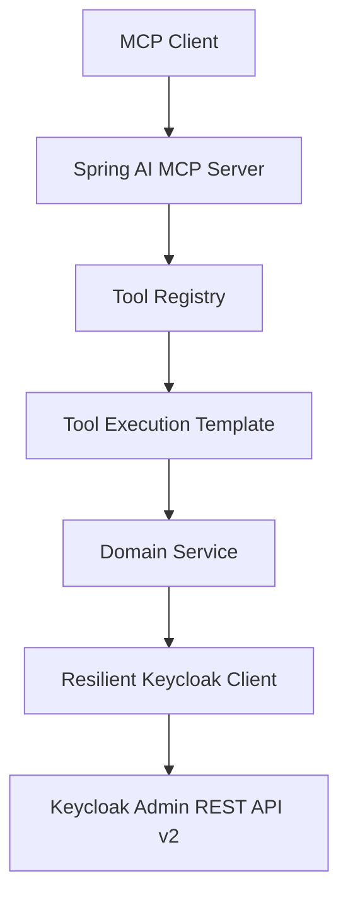

# Keycloak MCP Server

Production-grade MCP server exposing Keycloak 26.7.0 Admin REST API v2 capabilities as structured Spring AI tools.

Runtime baseline: Spring Boot 4.1.x.

## Highlights

- Spring Boot 4.1 + Java 21 + Spring AI MCP server
- Streamable HTTP transport configured for enterprise gateways, ingress, and service mesh
- Registry-driven MCP tool architecture for modular Keycloak domains
- Typed DTO contracts for critical mutation tools (users, clients, realms)
- Keycloak Admin API integration with retry, circuit breaker, bulkhead, timeout, and token caching
- Structured JSON logging, Micrometer metrics, tracing hooks, health indicators, and Prometheus exposure
- HTTP and STDIO MCP transports for AI clients such as Claude Desktop, Cursor, Continue, ChatGPT-compatible MCP clients, and custom agents
- Docker, Docker Compose, Kubernetes, and Helm deployment assets

## Package Structure

```text
io.github.sakc.keycloak.mcp
├── api
├── config
├── domain
│   ├── auth
│   ├── client
│   ├── error
│   ├── health
│   ├── observability
│   ├── security
│   └── service
├── mcp
└── tool
    └── provider
```

## Architecture



## Quick Start

```bash
mvn spring-boot:run
```

If you want the hardened enterprise defaults used for Streamable HTTP, run:

```bash
mvn spring-boot:run -Dspring-boot.run.profiles=enterprise
```

For STDIO transport:

```bash
mvn spring-boot:run -Dspring-boot.run.profiles=stdio -Dspring-boot.run.arguments=--spring.ai.mcp.server.stdio=true
```

For enterprise Streamable HTTP with JWT enforcement:

```bash
MCP_ENFORCE_HTTP_JWT=true \
MCP_STREAMABLE_HTTP_ALLOWED_ORIGINS=https://mcp.example.com \
MCP_STREAMABLE_HTTP_ALLOWED_HOSTS=mcp.example.com \
mvn spring-boot:run
```

The `enterprise` profile turns on JWT enforcement, forwarded headers, and stricter transport allow-lists.

For containerized local development:

```bash
docker compose up --build
```

## GitHub Copilot MCP Integration (VS Code)

This repository supports two Copilot MCP integration modes.

1. STDIO mode (recommended for local development)
    - Run `mvn -q -DskipTests package`, then copy `.vscode/mcp.json.example` to `.vscode/mcp.json` (git-ignored).
    - In VS Code, open Command Palette and run MCP: Open Workspace Configuration.
    - Confirm the server named `keycloak-admin-mcp` is enabled.
    - Copilot can then discover and call Keycloak tools directly from the workspace.

2. Docker HTTP mode (uses the running container)
    - Start services with Docker Compose.
    - Ensure MCP is reachable at `http://localhost:8080/mcp`.
    - Ensure Keycloak is reachable at `http://localhost:8081`.
    - Add an HTTP MCP server in VS Code/Copilot that points to `http://localhost:8080/mcp`.

## Other MCP Clients (Cursor, Continue, Claude, Windsurf, Cline, Codex, Gemini CLI, Zed)

Ready-to-paste configuration for each client (STDIO and HTTP) is in the [Client Setup Guide](docs/client-setup.md).
Minimal Cursor example (`.cursor/mcp.json`):

```json
{ "mcpServers": { "keycloak-admin": { "url": "http://localhost:8080/mcp" } } }
```

## Minimal Responses and `fields`

Read tools return a small default set of attributes to save tokens. Call `describe_response_fields` to see the
selectable fields per tool, then pass `fields` (e.g. `["clientId","publicClient"]`, or `["*"]` for everything) and
`first`/`max` for paging. See [Tool Schemas](docs/tool-schemas.md).

Quick validation endpoints:

- `http://localhost:8080/actuator/health`
- `http://localhost:8080/mcp`
- `http://localhost:8081`

## Documentation

- [Architecture](docs/architecture.md)
- [Tool Catalog](docs/tool-catalog.md)
- [Configuration Guide](docs/configuration.md)
- [Tool Schemas](docs/tool-schemas.md)
- [Client Setup Guide](docs/client-setup.md)
- [Client Compatibility](docs/client-compatibility.md)
- [Deployment Guide](docs/deployment.md)
- [Troubleshooting Guide](docs/troubleshooting.md)
- [Extension Guide](docs/extension-guide.md)
- [Agent Examples](docs/examples.md)
- [Roadmap](docs/roadmap.md)
- [Contributing](CONTRIBUTING.md)

## Internal REST Endpoints

- `/api/tools/catalog`
- `/mcp`
- `/actuator/health`
- `/actuator/info`
- `/actuator/metrics`
- `/actuator/prometheus`
- `/swagger-ui.html`

## Testing

```bash
mvn verify
```

MCP live regression (MCP-only tool calls against running server):

```bash
./scripts/mcp-functional-regression.sh
```

Optional overrides:

```bash
MCP_URL=http://localhost:8080/mcp \
MCP_ORIGIN=http://localhost:6274 \
MCP_PROTOCOL_VERSION=2025-11-25 \
./scripts/mcp-functional-regression.sh
```
