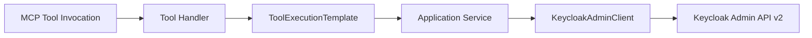
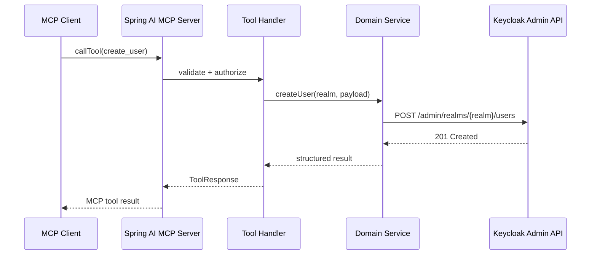

# Architecture

## Clean Architecture

## Sequence

## Design Notes

- Tools are registered through provider beans, not hard-coded in one class.
- Shared authorization, validation, rate limiting, audit logging, tracing, and response shaping live in `ToolExecutionTemplate`.
- New Keycloak domains can be added by implementing a service plus a provider.
